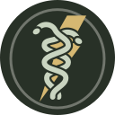
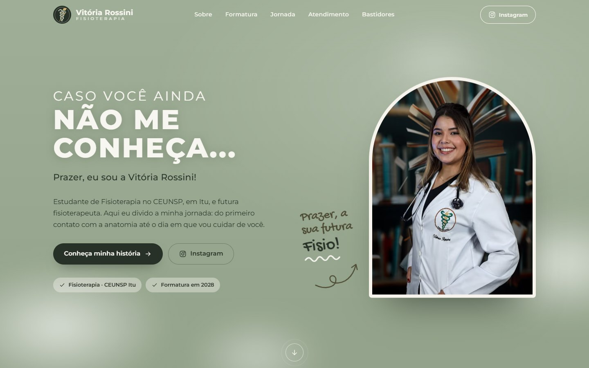
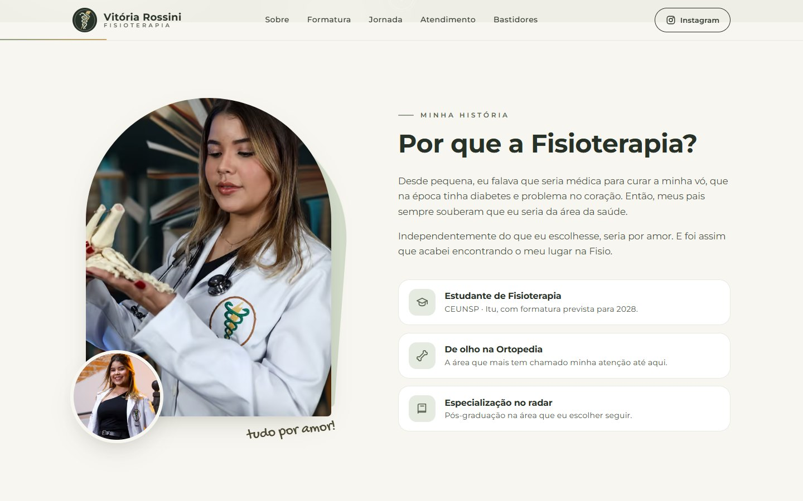
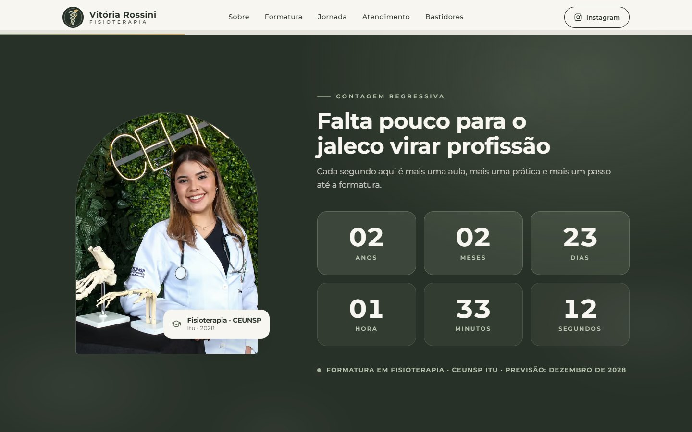
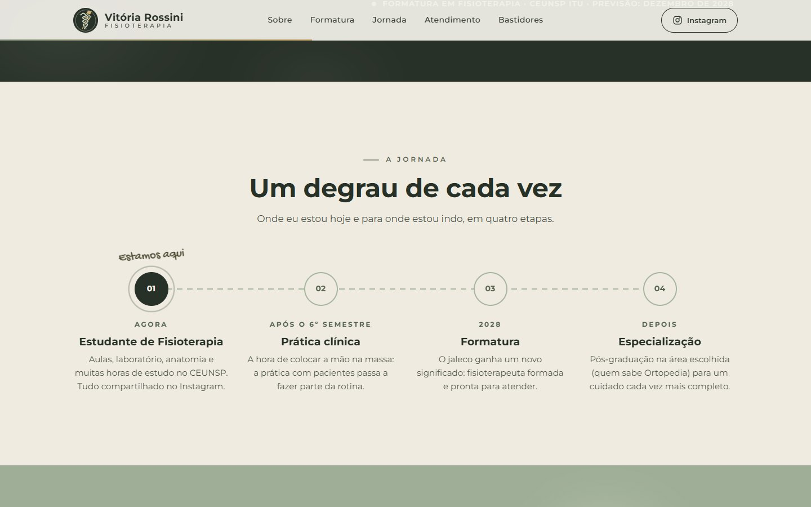
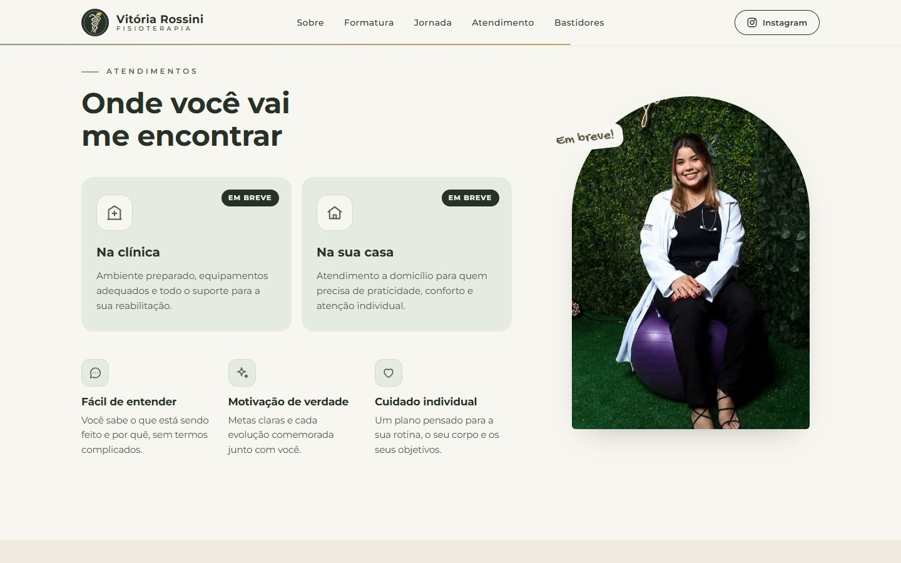
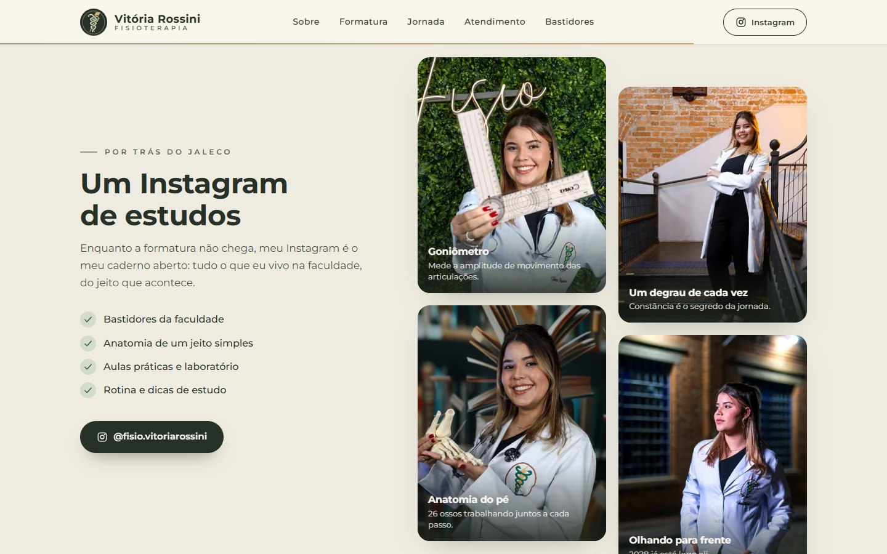
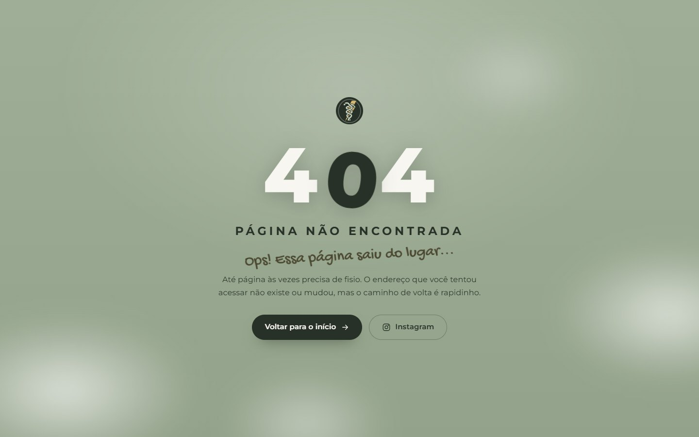
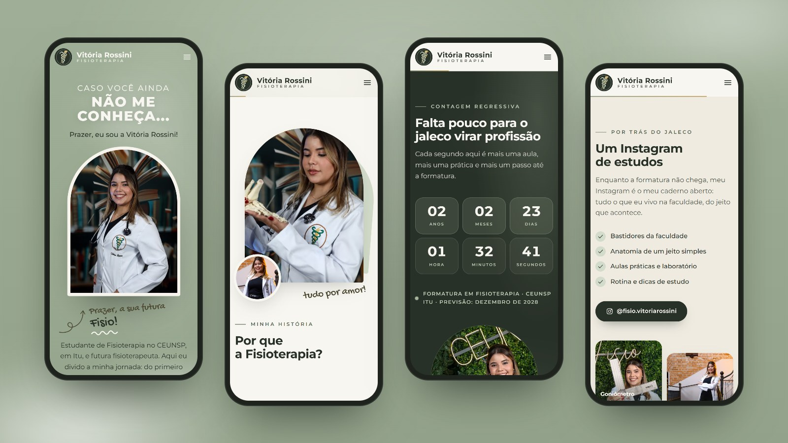
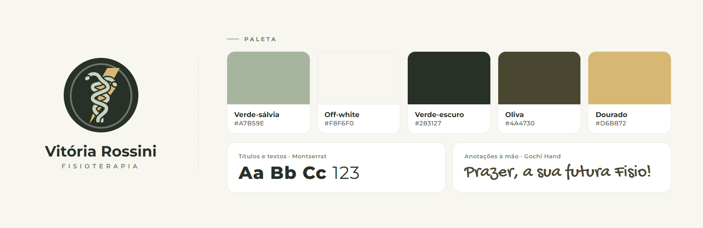

#  Vitória Rossini 

> Visite o site: [Vitoria Rossini - Landing Page](https://vitoria-rossini.vercel.app)

 

## Sobre o projeto

Landing page criada para Vitória Rossini, estudante de Fisioterapia no CEUNSP (Itu/SP) com formatura prevista para 2028.

Hoje, a página é a vitrine da jornada acadêmica dela e a porta de entrada para o seu Instagram de estudos, onde ela compartilha aulas, bastidores e tudo o que aprende na faculdade. Depois da formatura, o mesmo site vira o canal profissional para agendar atendimentos em clínica e a domicílio.

O visual foi construído a partir da identidade que ela já usa nos posts do Instagram: verde-sálvia, off-white, fumaça suave e anotações "escritas à mão". A intenção é que quem chegue à página se sinta acolhido e motivado, com tudo explicado de um jeito moderno e fácil de entender.

 

## Prévia

<table>
  <tr>
    <td width="50%">
      
      
<b>Minha história</b> Por que a Fisioterapia, contado por ela

    </td>
    <td width="50%">
      
      
<b>Contagem regressiva</b> Anos, meses, dias, horas, minutos e segundos até a formatura

    </td>
  </tr>
  <tr>
    <td width="50%">
      
      
<b>A jornada</b> Da sala de aula à especialização, um degrau de cada vez

    </td>
    <td width="50%">
      
      
<b>Atendimentos (em breve)</b> Clínica e domicílio, a partir da formatura

    </td>
  </tr>
  <tr>
    <td width="50%">
      
      
<b>Por trás do jaleco</b> Galeria e o Instagram de estudos

    </td>
    <td width="50%">
      
      
<b>Página 404 temática</b> “Ops! Essa página saiu do lugar...”

    </td>
  </tr>
</table>

### No celular

A maior parte das visitas chega pelo Instagram, então a página foi pensada primeiro para o celular.

 

## Destaques

- **Contagem regressiva ao vivo** até a formatura, com anos e meses calculados pelo calendário real (não por médias).
- **Linha do tempo da jornada**: estudante → prática clínica → formatura → especialização, com o marcador "Estamos aqui".
- **Abertura animada**: o selo da Fisioterapia se desenha, o nome aparece escrito à mão e a tela se abre ao meio, revelando o início da página.
- **Animações artesanais**: frases que se escrevem à mão, uma seta que se desenha até a foto, ícones que se desenham ao aparecer, cortinas que revelam as fotos e parallax suave. Tudo feito em CSS, sem bibliotecas de animação.
- **Microinterações** no hover: os ícones sobem girando com efeito de mola, ficam verde-escuros, soltam um anel e têm o traço redesenhado; no menu as letras rolam e o selo dá uma volta; os botões ganham um brilho.
- **Responsiva**, sem rolagem lateral, testada de 360px até telas largas.
- **Acessível**: respeita a preferência "reduzir movimento" do sistema, tem navegação por teclado, textos alternativos nas fotos e boa legibilidade.
- **Pronta para compartilhar**: card de prévia para WhatsApp e redes sociais, sitemap, robots e ícone próprio para a tela inicial do iPhone.
- **Rápida**: página estática gerada no build, fotos otimizadas automaticamente (AVIF/WebP) e fontes servidas pelo próprio site.

 

## Identidade visual

- **Logo**: redesenho do símbolo da Fisioterapia bordado no jaleco dela (serpentes entrelaçadas e raio), adaptado para a paleta do site.
- **Cores**: verde-sálvia e off-white, as cores preferidas dela, com verde-escuro para contraste, oliva para as anotações à mão e dourado nos detalhes.
- **Tipografia**: Montserrat nos títulos e textos, a mesma dos posts; Gochi Hand nas anotações "escritas à mão".

 

## Tecnologias

    

| Camada | Escolha |
| --- | --- |
| Framework | Next.js 16 (App Router), com a página gerada de forma estática |
| Interface | React 19 + TypeScript |
| Estilos | CSS Modules, sem frameworks de CSS |
| Animações | CSS puro (keyframes, IntersectionObserver e *scroll-driven animations*) |
| Imagens e fontes | `next/image` e `next/font` |
| Hospedagem | Vercel |

 

## Código-fonte

> [!NOTE]
> O código-fonte deste projeto é **privado**. Este repositório serve apenas como apresentação do trabalho.

 

## Direitos

Fotos, textos, nome e marca pertencem a **Vitória Rossini**. Todos os direitos reservados: não é permitido reproduzir ou reutilizar este conteúdo sem autorização.

<!-- Desenvolvido por: Guilherme Francisco Pereira-->

> Feito com carinho, para a mulher da minha vida. Eu te amo meu amor! 💚

